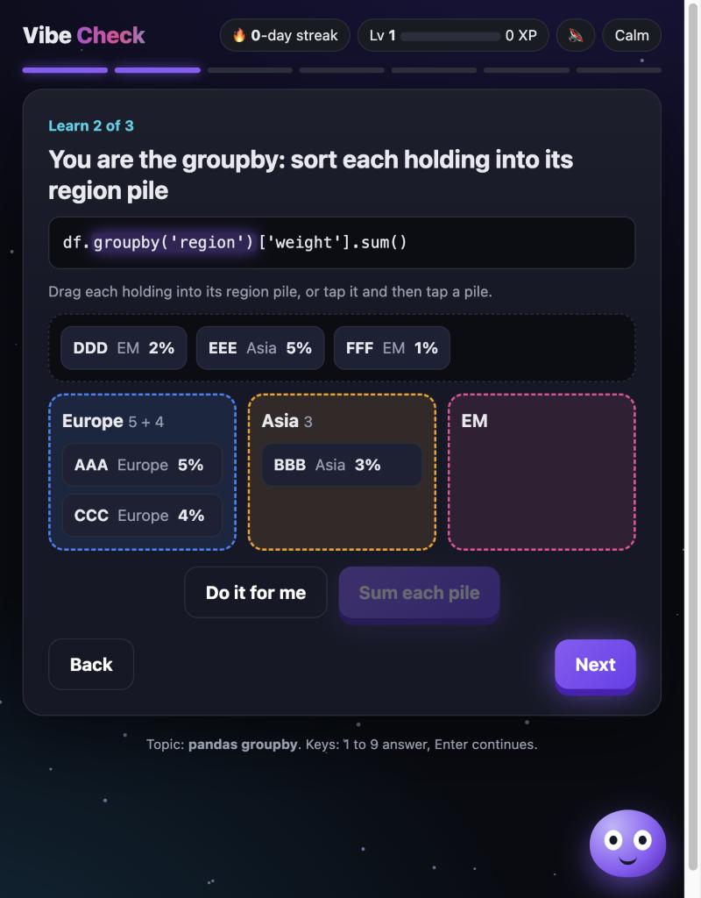
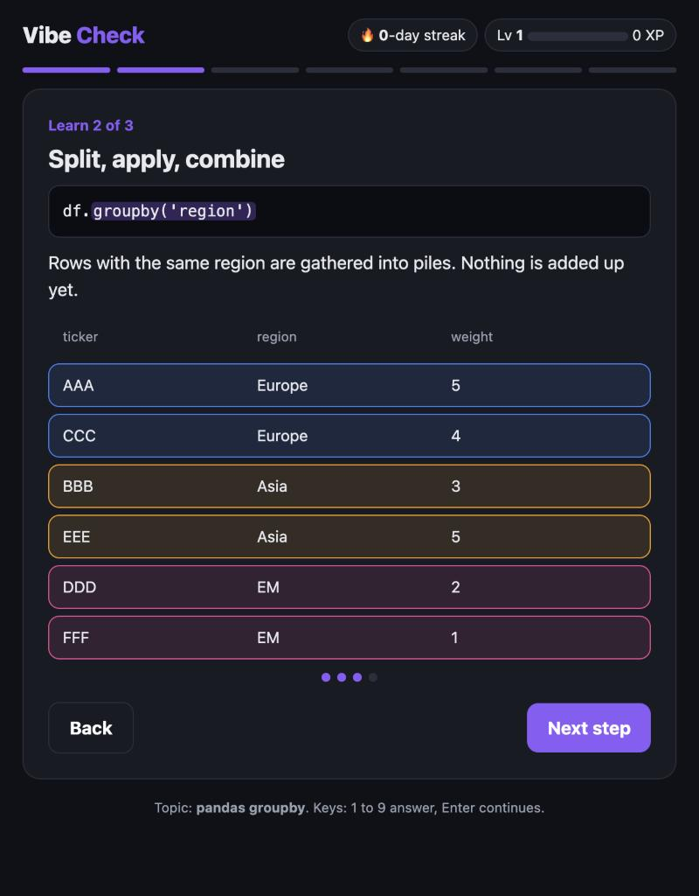
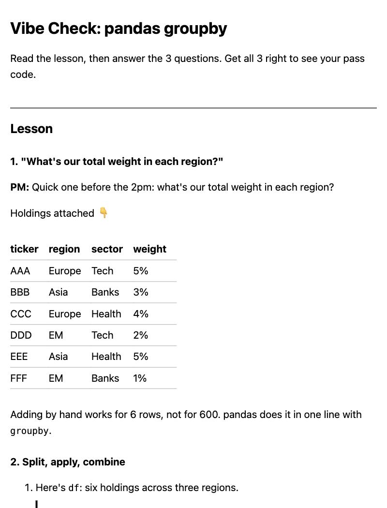

# Vibe Check ✅

**A Claude Code plugin that makes you pass a quick lesson and quiz before the code gets written. Learn as you vibe.**

Vibe coding is fun, but the code shows up and you never really learn what it does.
Vibe Check fixes that: when Claude Code is about to use a concept that's new to you, it opens a
short lesson and quiz in your browser. **No passing, no code.**



## How it works

1. You ask Claude Code to build something.
2. Claude spots a concept you haven't learned yet and opens a lesson and quiz in your browser.
3. File edits stay blocked until you pass. A miss shows the explanation, then you retry just that question.
4. You copy the pass code from the last screen, paste it into Claude Code, and it gets to work.
5. Concepts you've passed are remembered and never quizzed again.

Need to just ship? Type `/vibe-check:skip`. It's your tool. A skipped concept comes back next time.

## Install

In Claude Code:

```
/plugin install vibe-check --marketplace PatTheRatch/vibe-check
```

On versions before 2.1.275, do it in two steps:

```
/plugin marketplace add PatTheRatch/vibe-check
/plugin install vibe-check@vibe-check
```

It needs Python 3.9 or later on your PATH as `python3`. Nothing else: no packages, no
network, and the quiz pages are single files that open offline.

The first time it runs in a project it asks four quick questions (look, tracks, style, level).

## Three looks

Same lesson and questions in each. Pick one with `/vibe-check:config look <name>`.

| Look | What you get | Cost |
|---|---|---|
| `classic` (default) | Animated lesson cards and a quiz, with XP and streaks | Middle |
| `arcade` | A custom interactive scene built for the topic, plus sound, a mascot, combos and a vault that opens when you pass | Most tokens, slowest to appear |
| `plain` | One simple page: read, answer, done | Fewest tokens, fastest |

<p>


</p>

**About token use:** every Vibe Check adds a lesson's worth of work to your task, because
Claude writes the lesson for your topic. `arcade` adds the most, since it also writes a small
interactive scene. If usage matters, use `plain`, or set `trigger` to `big_concepts_only`.

## Lessons you do, not just read

Every lesson includes at least one scene where you do the concept with your hands. Claude
picks from a built-in library, in any look:

| Scene | You |
|---|---|
| Sort | drag items into the pile each belongs to |
| Match | drag each item onto its partner |
| Flow | step one request or number through the parts of a system |
| Slider | move a setting and watch what it changes |
| Build | assemble a line of code from pieces |
| Compare | flip between the data before and after |

Questions vary too: predict the output, fill the blank, spot the bug, put steps in order,
match terms, explain it to a coworker, and "what do you expect?".

## Learn the platform, not just the code

Not everyone cares how Python works. Every concept sits on one of three **tracks**, and you
choose which ones you get lessons on:

| Track | What it teaches |
|---|---|
| `domain` | What your system does in business terms: the rules, the math, the data flow |
| `architecture` | How the pieces fit together |
| `code` | The language, libraries and patterns |

`/vibe-check:config tracks domain,architecture` turns the code lessons off.

## A quiz that can find bugs

Domain lessons ask what you **expect** before showing what the code really does ("should a
blank weight stop the script?"). If the reveal isn't what it should do, press
**That's not what it should do**. It doesn't count against you. It's logged as a possible
issue, and Claude checks the code against your expectation and reports back. Either you
learn something or the code is wrong.

`/vibe-check:check <area>` runs one of these reviews on purpose, with no gate.

## Commands

| Command | What it does |
|---|---|
| `/vibe-check:status` | The gate, your level and streak, what you've passed here |
| `/vibe-check:skip` | Skip the pending quiz, on purpose |
| `/vibe-check:config` | Show settings, or change one: `/vibe-check:config fewer questions` |
| `/vibe-check:topics` | Everything you've covered, with a link to your Learning Log |
| `/vibe-check:review <topic>` | Replay a passed lesson and quiz, with no gate |
| `/vibe-check:scan` | For a project that already has code: list the concepts it uses |
| `/vibe-check:tour` | A guided lesson on how the whole project fits together |
| `/vibe-check:check <area>` | Review part of the code as a quiz on what you expect it to do |
| `/vibe-check:issues` | The possible bugs you flagged during quizzes |

You can also just say it: "teach me decorators", "make it easier", "what have we covered?".

## Settings

Saved per project in `.vibe-check/config.json`. Add `--global` to make one your default everywhere.

| Setting | Values | What it does |
|---|---|---|
| `look` | `arcade`, `classic`, `plain` | How the lesson page looks and feels |
| `tracks` | any of `domain`, `architecture`, `code` | Which kinds of concept get lessons and gates |
| `style` | `concepts`, `hands_on` | `concepts`: understand it well enough to explain it. `hands_on`: also write a small piece yourself |
| `level` | `beginner`, `intermediate`, `advanced` | How much the lesson assumes |
| `zoom` | `what`, `how`, `weeds` | Starting depth. It goes deeper when you ace things and simpler when you miss |
| `lesson` | `on`, `off` | Show the lesson before the quiz |
| `lesson_cards` | 2 to 8 | How many lesson scenes |
| `questions` | 1 to 10 | How many questions |
| `pass_bar` | `all`, or a number | How many must be right |
| `trigger` | `new_concepts`, `big_concepts_only`, `manual` | When a Vibe Check starts |

## Your Learning Log

Every Vibe Check is recorded in `~/.vibe-check/history.jsonl` on your own machine: the lesson,
each question, what you answered and how many tries it took. `~/.vibe-check/log.html` is a
page listing it all, with a Review link per topic. XP, level and streak are worked out from
that history. Nothing is sent anywhere.

## Good to know

- **It's a gate you set on yourself, not a security system.** The pass code sits inside the
  quiz page, lightly disguised. You can cheat. You'd only be cheating yourself.
- **What's blocked:** Claude's file edits (Edit, Write, NotebookEdit). Commands Claude runs
  in the shell are not blocked in this version, so the skill tells Claude not to use them
  as a way around.
- **If the gate itself breaks** while a quiz is pending, it stays closed and says so, and
  `/vibe-check:skip` still opens it. With no quiz pending it never blocks anything.
- Add `.vibe-check/` to your project's `.gitignore`.

## Develop

```bash
python3 -m unittest discover -s tests -v
```

```bash
claude --plugin-dir . 
```

The pieces: `scripts/gate.py` (the hook), `scripts/vc.py` (the CLI Claude runs),
`templates/` (the page looks), `skills/vibe-check/` (what tells Claude when and how),
`commands/` (the slash commands), `examples/pandas-playground/` (a worked example).

## License

See [LICENSE](LICENSE).
